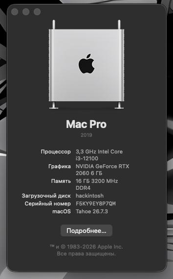

# MSI PRO B660M-E DDR4 + i3-12100 + RTX 2060 (Tahoe OpenCore EFI)

- **Motherboard:** MSI PRO B660M-E DDR4 (MS-7D46)
- **CPU:** Intel Core i3-12100
- **GPU:** Palit GeForce RTX 2060 GamingPro 6GB (NullMoth NVIDIA Driver v3)
- **RAM:** Patriot DDR4 8GB x 2 (3200MHz C16)
- **SSD:** WD Blue SN550 1TB NVMe (`WDS100T2B0C`)
- **Audio:** Realtek ALC897 (`layout-id = 11`)
- **Ethernet:** Intel I219-V (`IntelMausi 1.0.8`)
- **macOS version:** Tahoe 26.7.3
- **OpenCore version:** 1.0.8

